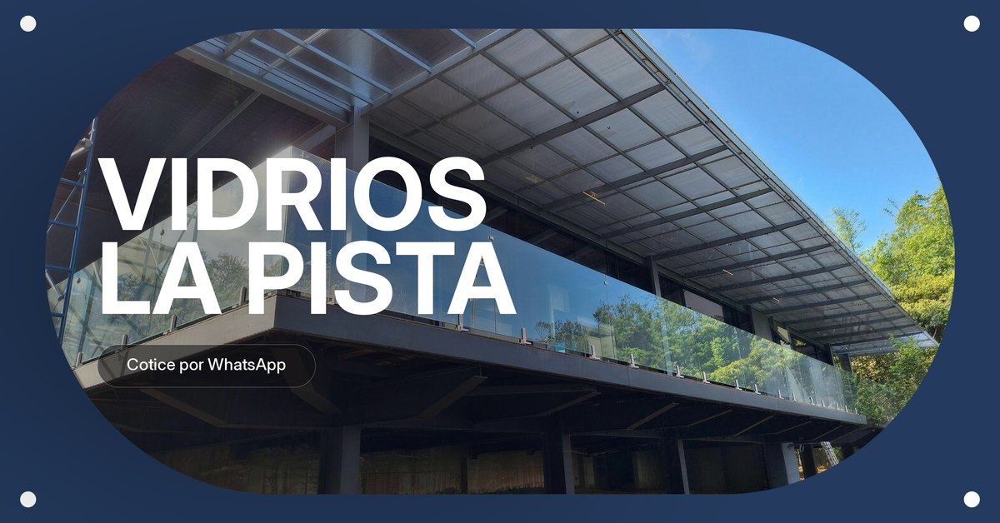

# Vidrios La Pista · página web

Página de una vidriera de Pérez Zeledón, Costa Rica: puertas y ventanas de vidrio y aluminio,
barandales de vidrio templado y puertas de baño, con instalación en todo el país.

**En línea:** https://vidrioslapista.pages.dev

*Website for a glass and aluminum installer in southern Costa Rica: scroll-driven video hero,
Spanish and English, and a quote form that opens WhatsApp.*



## Qué tiene

- **Recorrido en video que avanza con el scroll.** Arranca en una foto real de un barandal que
  instaló el negocio y sube hasta la vista del valle (video generado con IA a partir de esa foto).
  Encima pasan tres capítulos: qué hacen, 25 años de experiencia y barandales.
- **Galería de 34 trabajos reales** con filtros y visor. Las 13 principales tienen mejora de
  resolución; la cuadrícula usa miniaturas livianas para el celular.
- **Cotizador** que abre WhatsApp con el mensaje armado, botón de llamar y mapa del taller.
- **Español e inglés**: según el idioma del teléfono, el botón EN/ES o `?lang=en` en el enlace.
- **Para Google y WhatsApp**: datos estructurados de negocio local y vista previa al compartir.

## Cómo está hecho

HTML, CSS y JavaScript puros, sin dependencias ni compilación. El video se baja una sola vez y su
`currentTime` sigue a la posición del scroll, así que avanza y retrocede sin cortes.

## Verlo en la compu

```bash
python -m http.server 8000
```

Y abrir http://localhost:8000.

## Límites

- No tiene servidor: el formulario no guarda nada, solo arma el mensaje de WhatsApp.
- El video pesa 14 MB en computadora y 8,5 MB en celular; mientras baja se ve la foto de portada.
- El teléfono, la ubicación y las fotos son los que el dueño del negocio entregó para publicar.

Hecha por Pablo Guerrero · pabloguerrerocr@gmail.com
